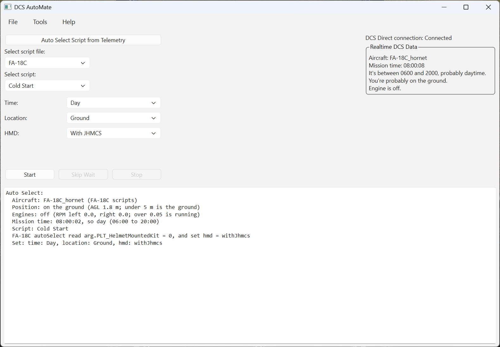
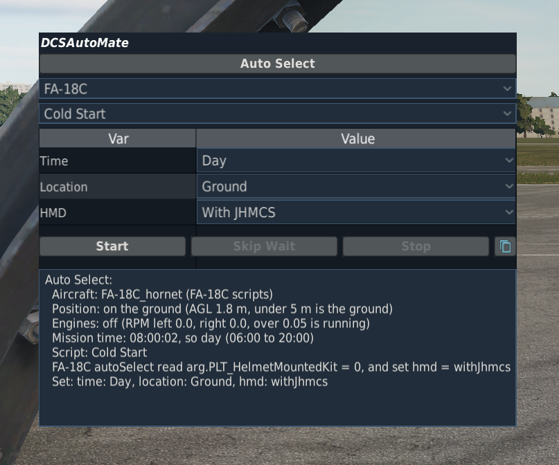
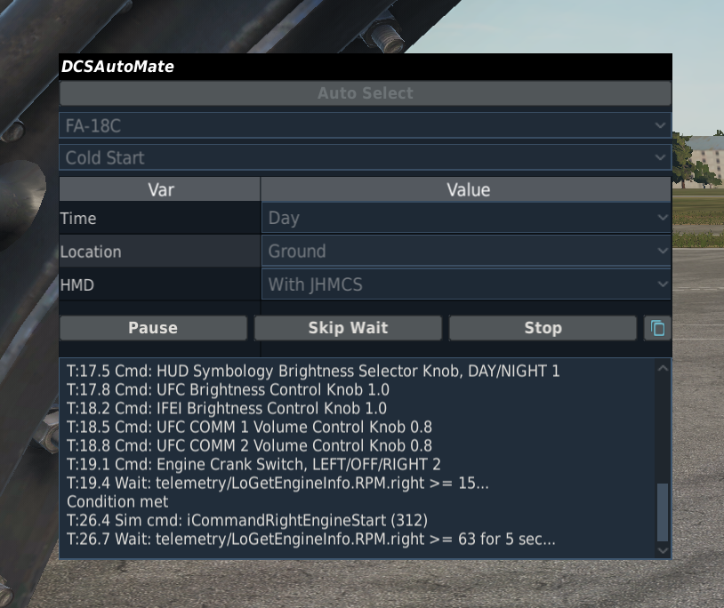

# DCSAutoMate 2.0.0
Python scripting engine for DCS World.

This program sends commands to DCS via a custom Lua export script (`DCSAutoMateExport.lua`) that talks directly to the game's native control APIs over TCP.  It also uses [pydirectinput](https://github.com/learncodebygaming/pydirectinput) to send keyboard commands.

This is intended to replace the existing built-in autostart scripts in DCS, which after v.2.8 became subject to the "Pure Scripts" flag on multiplayer servers.  In order to modify the built-in startup scripts, you have to change the actual game files, which makes them fail the IC check if Pure Scripts is enabled.  DCSAutoMate is not affected by this check because its commands go through the user-editable Lua export script in Saved Games.

DCSAutoMate can also be used to script any other cockpit commands, such as adding waypoints or setting countermeasures programs.

> **Note on DCS BIOS:** Older versions of DCSAutoMate required [the DCS BIOS fork for DCS Flightpanels](https://github.com/DCSFlightpanels/dcs-bios) as a command channel.  That dependency has been removed.  DCS BIOS is no longer required or used.

# How to use this program

**Installation and setup**

1. Download `DCSAutoMate-<version>.zip` from the [Releases page](https://github.com/SlipHavoc/DCSAutoMate/releases) and extract it to a folder of your choice.  Keep all the files together; the programs look for their data files in their own folder.
2. Run **DCSAutoMate.exe**.  It should detect that the DCSAutoMate script files need to be added to your Saved Games DCS folder and install them automatically.  (You can install or re-install them manually if needed by going to **Settings → Install/Update DCS Scripts...**.)  This also adds an include line to your `Export.lua` if needed.  It will warn you before overwriting existing files.

The exes aren't code-signed, so Windows SmartScreen may warn that it doesn't recognize them the first time you run them.  Click **More info**, then **Run anyway**.

Microsoft Defender finds no threats in the exes, but on VirusTotal a few of the roughly 70 antivirus engines flag them (3 for DCSAutoMate.exe and 4 for DCSControlPanel.exe at release, all generic or machine-learning detections).  This is a known false positive with Python programs packaged into a single exe by PyInstaller.  If you'd rather not trust the exes, you can run DCSAutoMate from the Python source instead (see **Running DCSAutoMate.py as a Python program** below).

**Basic use**

1. Double-click **DCSAutoMate.exe** to run the program.  Keep the DCSAutoMate window open (you can minimize it if you want).
2. Start DCS.
3. When you're in cockpit and ready to run a script, press the hotkey (**Ctrl+Shift+Z** by default) to open the in-game overlay.
4. Select the module (the plane you're in), then the script you want to run, and any options for that script that appear.
5. Click the **Start** button to start running the script.  The script will start sending commands to DCS.
6. After the script is done, you can close the in-game overlay with the same hotkey, or leave it open and ready to run another script.  To stop a script while it's running, click the **Stop** button, or alt-tab out and close the DCSAutoMate window.  While the script is waiting (for a cockpit state, a Loop Until condition, or a timer), **Skip Wait** ends the wait and goes on to the next step.

You can run any script at any time; it's up to you to run the *right* script at the *right* time.



Optionally, you can set a few configuration options for the program by selecting **Tools > Settings...**.  See below for explanation of settings.

**In-Game Interface**

DCSAutoMate 2.0 introduces a new in-game interface (overlay) that allows you to control the program without alt-tabbing out of the game.
* **Hotkey**: Press **Ctrl+Shift+Z** (default) to toggle the overlay.
* **Module Selection**: Automatically detects the current module if possible, or allows manual selection.
* **Script Selection**: Choose from available scripts for the selected module.
* **Options**: Configure script-specific options directly in the overlay.
* **Control**: Start, Stop, and Skip Wait from within the game.

 

**Supported aircraft**

| Aircraft | Included Scripts |
|---|---|
| A-4E-C | Cold Start, Hot Start |
| A-10C | Cold Start, Hot Start, Air Start, Shutdown |
| A-10C II | Cold Start, Hot Start, Air Start, Shutdown |
| AH-64D | Cold Start, Hot Start, Shutdown, Load Route, Load Scratchpad |
| AJS37 | Cold Start, Hot Start, Reload Data Cartridge |
| AV-8B N/A | Cold Start, Hot Start, Shutdown |
| C-101CC, C-101EB | Cold Start, Hot Start |
| C-130J-30 | Cold Start, Cold Start with Preflight, Hot Start, Air Start, Shutdown |
| CH-47F | Cold Start, Hot Start, Shutdown |
| F-4E | Cold Start With Jester, Cold Start No Jester, Auto Start, Hot Start, Air Start |
| F-5E | Cold Start, Hot Start |
| F-15E | Cold Start, Hot Start, Air Start, Shutdown, Load Route, Load Scratchpad |
| F-16C | Cold Start, Hot Start, Air Start, Shutdown, Load Route, Load Scratchpad |
| F-86F | Cold Start, Hot Start, Air Start, Shutdown |
| FA-18C | Cold Start, Hot Start, Air Start, Shutdown, Load Route, Load Scratchpad |
| Ka-50 Black Shark II | Cold Start, Hot Start |
| Ka-50 Black Shark III | Cold Start, Hot Start, Shutdown |
| Mi-8MTV2 | Cold Start, Hot Start, Shutdown |
| Mi-24P | Cold Start, Hot Start, Air Start, Shutdown |
| OH-58D | Cold Start, Hot Start, Shutdown |
| UH-1H | Cold Start, Hot Start, Shutdown |

Only the aircraft listed above are supported by DCSAutoMate 2.0.0, as they're all the ones I've extracted the control definitions for.  To support other aircraft, you will either need to extract the control definitions yourself or wait for a future version of DCSAutoMate that includes them.

**DCSControlPanel**

DCSControlPanel.exe, included in the zip, is a utility for script authors.  It shows the live value of any cockpit control you add to it and lets you operate the control from the desktop.  Its Snapshot Tool records the whole cockpit state so you can find which controls changed after you flip a switch.  **Help > Control Reference** in DCSAutoMate lists every control of every supported aircraft by the name scripts use.

**Settings**

Open the Settings window in the app by clicking the **Tools** menu, then **Settings...**.  Here are the options:

* **Debug** - If checked, you can still run scripts, but no data will be sent to DCS, and DCS doesn't even have to be running.  scriptCockpitState commands will automatically be assumed to meet their conditions (but will still wait for the required duration, if any).  This allows you to test scripts without having to be in the game.
* **Disable Text-to-Speech output** - If checked, no speech will be generated and DCSAutoMate will run silently.
* **In-Game Overlay Hotkey** - The hotkey to toggle the in-game overlay. Defaults to Ctrl+Shift+Z.  Use Ctrl, Alt and Shift as modifiers; left/right-specific modifiers such as LCtrl aren't supported.
* **DCS executable path** - If filled in, DCSAutoMate will use this DCS.exe instead of the one it finds from the registry.  The gray line under the field shows which DCS.exe is actually in use.
* **Find DCS window by window title** - If checked, will make DCSAutoMate try to find the DCS window by searching for the title.  If not checked (default), DCSAutoMate will try to find the DCS window by searching for the Windows process executable, which should be more reliable.  The DCS window is needed in order to send keyboard commands.
* **DCS window title** - If filled in (and "Find DCS window by window title" is checked), DCSAutoMate will look for a window with this value anywhere in its title (case-insensitive) and send the script keyboard commands to the first one it finds.  If left blank, defaults to "Digital Combat Simulator".
* **DCS Saved Games folder path** - If filled in, DCSAutoMate will use this value for the path to the Saved Games folder.  You can use the string `%USERPROFILE%` to represent your personal Users folder.  This path is needed in order to install the DCS-side export script and overlay hook.  If left blank, DCSAutoMate will look for `%USERPROFILE%\Saved Games\DCS`, and if that folder doesn't exist it'll look for `%USERPROFILE%\Saved Games\DCS.openbeta`.  The gray line under the field shows which folder is actually in use, or "Override not found" if the folder you entered doesn't exist.
* **Text-to-Speech** - The voice, speaking rate and volume used for spoken script output.  **Preview Voice** plays a sample with the current choices.
* **Network Communication Ports** - The network ports used for the TCP connection to the DCS export script and for the in-game overlay.  Leave them at defaults unless you know what you're doing.
* **Logging** - Troubleshooting logs for the in-game overlay; leave them off normally.
  * **Log in-game overlay network traffic in DCSAutoMate** - DCSAutoMate records every message it sends to or receives from the in-game overlay in DCSAutoMateLog.txt in the program folder.
  * **Write DCS hook log file** - The DCS-side overlay hook writes a log to Logs\DCSAutoMateHook.log in your DCS Saved Games folder.  The two options under it add to that log, so they're only available when it's checked:
    * **Include debug messages** - Extra detail about what the hook is doing.
    * **Log in-game overlay network traffic in DCS** - The same overlay messages as above, as seen from the DCS side.  Comparing the two logs shows whether a message was lost in between.

**Saved config and settings files**

DCSAutoMate stores its configuration settings in DCSAutoMateConfig.json, and it remembers the last script and options you picked by storing them in DCSAutoMateSettings.json.  You can edit those files manually if you wish, but it's not recommended.  If they get messed up, you can just delete them, and DCSAutoMate will create new ones with default settings.

**Running DCSAutoMate.py as a Python program**

If using DCSAutoMate.exe, no installation or other programs should be needed.  The exe is built with a Python build script (included in the `tools` folder) and includes all necessary dependencies.

If using DCSAutoMate.py, you will need to have [Python 3.13 or greater](https://www.python.org/downloads/windows/) installed, as well as the necessary dependencies, libraries, etc.  The DCSAutoMate.py is normally run in a Python virtual environment (venv), and I recommend you use the DCSAutoMate.bat file to run the app instead, which will set up the virtual environment automatically when it runs.

# Creating/modifying script files, script file output format, and available commands
Use the scripts that come with DCSAutoMate as examples.  The script functions in the .py files in the DCSAutoMateScripts subfolder ultimately return a Python `list`.  Each element in the `list` must be a `dictionary`.  The `dictionary` keys you need depend on the command.  Here are the current valid commands, what they do, and the keys they must have in their `dictionary`:

All commands must have at least these 2 keys:

>'time': \<float\>, # The number of seconds after the previous command that this command will be executed.  I recommend **0.3** seconds to avoid problems with lag in multiplayer servers, although in single player with a fast computer you can often use 0.1.  All the included scripts default to 0.3.

>'cmd': \<string\>, # The command to be executed.  This must either be a canonical control name recognised by DCSAutoMate (the `<deviceName>.<cmdName>` key from `config/controlMappings/<module>.json`, or `arg.<N>` / `ind.<id>.<field>` for raw argument / indicator reads), or one of the special command strings starting with `script...` listed below.

To look up control names, use **Help > Control Reference**.  It opens `docs/controlReference.html` in your browser, a searchable list of every module's controls with the values each one takes, one control per line, and buttons to copy the name or description.  DCSAutoMate rebuilds the page's data (`docs/controlData/`) at startup whenever a control mapping has changed; you can also run `python -m utils.controlReference`.

Here are the additional keys supported by each command:

**Cockpit control commands**

This moves a cockpit control in DCS.

>'arg': \<string or int\>, # The parameter value for the command.  For switches and knobs with discrete values, it's usually a position index (0, 1, ..., N-1).  For continuously-rotating knobs, relative values such as '+1' or '-1' move by one click.  For continuous controls with end stops, it's a number between the control's `argLim` values.  The unified control mapping format (`config/controlMappings/<module>.json`) documents the valid `arg` type for every control.

>'msg': \<string\>, # Optional, defaults to ''.  A message to be displayed when the command executes.

**scriptKeyboard**

This sends a keyboard input to DCS, as if you had pressed a key.  Some cockpit controls (such as "Move throttle to idle") don't have native command mappings, so you can move them by sending a key press to DCS instead.  As of DCSAutoMate 2.0.0, this is not used in any of the included scripts, as I was able to use the new simulator commands (`scriptSimCommand`) for everything I had previously used keyboard commands for.  I recommend avoiding keyboard commands if possible, as using them means you must remain in the cockpit as the script is executing, or the keyboard command may not function correctly.

>'arg': \<string\>, # The keyboard key to be sent to DCS.  A list of supported key names can be found here: https://pyautogui.readthedocs.io/en/latest/keyboard.html#keyboard-keys .  The string can be either a single key, or a key and an action, separated with a space.  Examples: 'a', presses and releases the letter A key.  'add', presses and releases the numpad + key.  'RCtrl down', presses and holds the RCtrl key.  'RCtrl up' releases the RCtrl key.  Only one key can be sent per command, so for combinations like RCtrl+Home, you need to send 'RCtrl down', 'home', 'RCtrl up' as three separate commands.  DCSAutoMate accepts several aliases for the keyboard keys so you can use 'RCtrl' instead of 'ctrlright' for instance, or 'num+' instead of 'add'.

>'msg': \<string\>, # Optional, defaults to ''.  A message to be displayed when the command executes.

**scriptSimCommand**

This sends a simulator command straight to DCS with `LoSetCommand`, without pressing a key, so DCS doesn't need keyboard focus and the command doesn't count as a keyboard command.  Simulator commands are the ones a module's keybindings list as `iCommand...` (no `cockpit_device_id`), such as throttle IDLE/OFF.  For example, `pushSeqCmd(dt, 'scriptSimCommand', 'iCommandRightEngineStart')` does the same as RShift+Home ("Throttle (Right) - IDLE") in the FA-18C.  Multiplayer servers that block `Allow player export` ignore simulator commands from clients, so they silently do nothing there.  However, most MP servers don't block `Allow player export`, as it's needed for things like DCS BIOS and full cockpit setups to work, so scriptSimCommand is generally safe to use.

>'arg': \<string or int\>, # The simulator command's `iCommand...` name or number.  Names come from `config/simCommands.json`, DCS's own name/number table exported by the Hook (it writes a fresh copy to `Saved Games/DCS/Logs/DCSAutoMateSimCommands.json` when a mission starts); an unknown name fails script validation and isn't sent.  Names are case-sensitive, and DCS isn't consistent: the comms menu commands start with a capital I (`ICommandMenuItem1`), almost everything else with a small i (`iCommandToggleCommandMenu`).  A name that's only wrong by case fails validation with the right spelling suggested.

>'value': \<number\>, # Optional.  A value for axis-style commands (e.g. `LoSetCommand(3, 0.25)`, rudder 0.25 right).  Your own joystick axis takes over as soon as it moves (even a little jitter counts), so to keep an axis at a value, hold it (below).

>'hold': \<number or True\>, # Optional.  Seconds to hold the command like a held key: DCS repeats it every frame (sim time, so pausing extends it), or `True` to hold it until a `release` step.  Movement commands usually keep going until their stop command (e.g. `iCommandPlaneCollectiveDecrease` then `iCommandPlaneCollectiveStop` two seconds later, as two plain rows), so this is only for a command that acts just while it's being repeated.  Each module decides what a command does, so test it: `iCommandThrottleIncrease` keeps moving the Mi-8 and Mi-24 correction lever until `iCommandThrottleStop`, but only nudges the AV-8B throttle one small step per command (11 steps from cutoff to idle).  The script doesn't wait for the hold, so give the next row the hold time.  With `value`, it holds an axis at that value, overriding your own control inputs, e.g. the C-130J's throttles at ground idle through an engine start: `pushSeqCmd(dt, 'scriptSimCommand', 'iCommandPlaneThrustCommon', 'Throttles to GND IDLE', value=0.678, hold=True)`.  When the hold ends, the axis stays put until you move your own physical controls, then jumps to match your control inputs.  Whatever the script still holds is released when it ends, is stopped, or fails, and if DCSAutoMate disconnects.

>'release': True, # Optional.  Ends this command's hold now, e.g. `pushSeqCmd(dt, 'scriptSimCommand', 'iCommandPlaneThrustCommon', release=True)`.  Can't be combined with `hold`, `stop` or `value`.

>'stop': \<string or int\>, # Optional, needs `hold`.  The command to send once when the hold ends, i.e. the binding's `up` command (e.g. `iCommandPlaneCollectiveStop`).

>'msg': \<string\>, # Optional, defaults to ''.  A message to be displayed when the command executes.

The comms menu works through sim commands in any view: `ICommandMenuItem1`-`ICommandMenuItem10` are F1-F10, `ICommandMenuItem11` goes back one level, and `ICommandMenuItem12` exits the menu and resets it to the top level.  The menu doesn't need to be open for item commands to work, but it remembers which submenu it's on until it's reset (by F12 / `ICommandMenuItem12`, or by `\` / `iCommandToggleCommandMenu`), so start a menu sequence with `ICommandMenuItem12` to begin from the top level.  The player's own `\` or F-key presses during a menu sequence will change the menu state and throw it off, so a script that uses the comms menu (any `ICommandMenu...` command, or `iCommandToggleCommandMenu`, by name or number) says "Don't use comms menu until told it's OK" when it starts, and "OK to use comms menu" after the last one.  If the script also needs the cockpit, the two warnings are combined into one; the all-clears are still separate.  Live scripts get the same lookahead as the cockpit all-clear.

**scriptSpeech**

This makes DCSAutoMate speak a message out loud.  Useful to let you know what's happening in the script as it runs, or remind you to do certain things.

>'arg': \<string\>, # This is a string which will be spoken out loud by Microsoft Text-To-Speech.

>'msg': \<string\>, # Optional, defaults to ''.  A message to be displayed when the command executes.

**scriptCockpitState**

This makes the script wait until a particular control in the cockpit is at/above/below a particular value before continuing.  For instance, you can set the canopy switch to down, and then monitor the canopy position until it's at 0, and then set the canopy switch to neutral.  Or start an engine, and then monitor the engine RPMs until they're over some value, and then move the throttle to the idle detent.  Previously you would have to time how long something takes and hardcode that number of seconds into the script.  You can still do that, but scriptCockpitState makes the script more natural, and lets the script respond to dynamic cockpit events, such as an alignment that takes a variable amount of time, or engines that take longer to come to idle in extreme cold weather.

Internally, scriptCockpitState queries the current control value from DCS over TCP (via `DCSDirectManager`) and compares the returned value to the desired value using the provided comparison operator (equals, or greater/less than), optionally requiring the condition to hold for a given number of seconds before continuing.

>'control': \<string\>, # A canonical control name (`<deviceName>.<cmdName>` or `arg.<N>` / `ind.<id>.<field>`), or a telemetry value (see below).  The module prefix (e.g. `'FA-18C_hornet/...'`) is not needed; `DCSDirectManager` resolves against the currently loaded module.

>'condition': \<string\>, # The comparison operator that will be used to compare the control's current state in the cockpit to the value.  Can be: '=', '<', '<=', '>', or '>='.  For string values, only '=' is supported.

>'value': \<string or int\>, # The value that will be compared to the control's current state in the cockpit.  The cockpit state value will be cast to this value's type (int or str) before comparing.

>'duration': \<int\>, # Optional, defaults to 0.  Number of seconds the condition and value must be met before continuing.

>'resolution': \<int\>, # Optional, defaults to 5.  Number of decimal places to round the DCS-returned control value to before comparing.  Absorbs the 32-bit float precision artifact from DCS's Lua engine (e.g. a fully-open canopy returns 0.89999997... rather than exactly 0.9).  Comparable precision to DCS BIOS's 16-bit integer resolution (~1.5×10⁻⁵).  Only applies to numeric comparisons.

**Cockpit displays (`ind.` controls) only update while you're in the cockpit.**  They're read from the cockpit's rendered displays (IFEI, CDU, UFC, ...), which DCS stops updating in the F10 map or outside views.  `arg.` controls (switches, gauges, lights) keep updating, and telemetry comes from the simulation rather than the displays.  A script that waits on or reads an `ind.` control therefore keeps you in the cockpit the same way keyboard commands do (see **scriptCockpitDone**).  Where there's an `arg.` or telemetry equivalent, prefer it.

**Telemetry controls (`telemetry/...`)**

Anything DCS's export `LoGet*` functions report can be used wherever a control name is accepted (`scriptCockpitState`, `scriptLoopUntilStart` / `End`, `helper.read()`), as `telemetry/<function>[.<field>...]`.  For example, engine RPM in percent, which comes from the flight model rather than a cockpit display like the FA-18C's IFEI:

```python
pushSeqCmd(dt, 'scriptCockpitState', control='telemetry/LoGetEngineInfo.RPM.right', condition='>=', value=15)
```

The `telemetry` module at the top of DCSControlPanel's module list shows the common fields (engine, fuel, gear/flaps, position, payload, and since DCS 2.9.30 the player's seat in multicrew aircraft, time acceleration, multiplayer and track replay) so you can watch them live.  Any other field of a `LoGet*` result works too (list entries are numbered from 1, as in Lua, e.g. `telemetry/LoGetPayloadInfo.Stations.1.count`).  Telemetry values are whatever the module's flight model reports, so check them against the cockpit gauge before relying on a threshold.

Multiplayer servers can block telemetry: with the server's `Allow player export` setting off, every `LoGet*` flight-data function returns nothing to clients (the host isn't affected).  A wait on a telemetry value would then never finish, so before running, DCSAutoMate checks each `LoGet*` function the script's waits and loops use, and if DCS doesn't answer for one it warns and pauses the script.  Click **Stop**, or **Resume** and click **Skip Wait** when the script gets stuck at that wait.  `arg.` and `ind.` controls still work on these servers, so if a script must work everywhere, use cockpit gauges or displays (ind.* and arg.*) and keyboard commands to move controls if needed.

**scriptLoopUntilStart and scriptLoopUntilEnd**

These are paired markers that bracket a block of commands which should be repeated until a cockpit-state condition is met.  Typical uses: incrementing/decrementing a multi-press control until the cockpit displays the target value (e.g. bingo fuel setpoint), or controlling a "toggle" command that doesn't honor absolute set-state semantics by reading the resulting state and re-toggling if the wrong state was reached.

The condition can be specified on either marker.  When specified on `scriptLoopUntilStart`, it acts as a pre-test (while-style) — if the condition is already met, the body is skipped.  When specified on `scriptLoopUntilEnd`, it acts as a post-test (do-while-style) — the body always runs at least once.  If both markers specify a condition, the End marker's parameters are used for the post-iteration recheck.  If neither marker specifies a condition, the loop is bounded only by `maxIterations` / `timeout`.

The same parameters as scriptCockpitState are used (`control`, `condition`, `value`).  Two additional optional parameters cap runaway loops:

>'maxIterations': \<int\>, # Optional, defaults to 0 (unlimited).  Maximum number of iterations before giving up and continuing.

>'timeout': \<int\>, # Optional, defaults to 0 (unlimited).  Maximum wall-clock seconds before giving up and continuing.

When a budget is exceeded the loop exits with a warning message; this is not treated as a fatal error.  Loops can be nested.

Example — toggle a cover until it's fully open, with a small per-iteration settle pause:

```python
pushSeqCmd(dt, 'scriptLoopUntilStart', control='Ka-50/UV_26.UV26_POWER_COVER_PTR', condition='=', value=1.0, maxIterations=3)
pushSeqCmd(dt, 'UV_26.UV26_POWER_COVER_PTR', 1)
pushSeqCmd(0.5, '', '')
pushSeqCmd(dt, 'scriptLoopUntilEnd')
```

**Live scripts (`yield`)**

A script function normally builds its whole command list before anything runs, so an `if` in the script is decided before the first command is sent.  To decide something from the cockpit's state at the moment it matters, put a bare `yield` in the script function.  At each `yield`, every command queued so far runs; then the function continues from the line after the `yield`, and `helper.read()` returns the control's current value:

```python
pushSeqCmd(dt, 'MDI_RIGHT.MDI_PB_11', 1)
pushSeqCmd(dt, 'MDI_RIGHT.MDI_PB_11', 0)
yield # Run everything above before looking at the cockpit.
if helper.read('arg.PLT_HelmetMountedKit', default=0) < 0.25: # 0 = JHMCS, 0.5 = none, 1 = NVG
	pushSeqCmd(dt, 'HMD_INTERFACE.BrtKnob', 1.0)
```

>`helper.read(control, default=...)`: The control's current value.  Bare names get the script's module prefix.  If DCS doesn't answer (e.g. not connected), returns `default`, or raises an error if no default was given.  An unknown control name is always an error.

Scripts without a `yield` work exactly as before.  Things to know about live scripts:

- Use `pushSeqCmd = helper.makePushSeqCmd(seq)`, not a local `pushSeqCmd` definition; that's how the executor finds the queued commands.
- A nested function that itself contains a `yield` must be called as `yield from myFunction()`.  A plain `myFunction()` call silently runs none of its commands.  `tests/test_liveScriptLint.py` checks every script for this.
- Control names are checked as each batch runs, not all before the script starts.
- `scriptLoopUntilStart` and `scriptLoopUntilEnd` must be in the same batch (no `yield` between them).  In a live script an ordinary Python `while` loop with a `yield` inside does the same job.
- "OK to leave cockpit" still works.  At each `yield` the script's code is scanned for keyboard commands and `ind.` reads that can still be reached from where it paused (later lines, an enclosing loop, helper functions called later).  If the scan can't be sure, the announcement waits for the final batch, where it's exact.  Put `pushSeqCmd(dt, 'scriptCockpitDone')` after the last one to announce it at exactly that point instead.

**scriptCockpitDone**

Optional.  Announces "OK to leave cockpit" at this point, for scripts where the last keyboard command or `ind.` read can't be detected automatically.  A keyboard command or `ind.` wait after it is reported as an error when the script is checked; if one is reached anyway, the script pauses and asks you to return to the cockpit before continuing.

**scriptTimerStart and scriptTimerEnd**

This is used to time long-duration events, where you want to execute commands in the meantime.  For instance, with an INS alignment that takes a fixed amount of time, you start the alignment, then start a timer with scriptTimerStart for the required alignment time.  The script then continues executing commands until it gets to the scriptTimerEnd.  If enough time has elapsed already since the timer was started, it'll continue to the next command immediately.  Otherwise the script will wait until the timer duration has passed, and then continue.  Timers count DCS mission time, so accelerating time in DCS shortens the wait along with the alignment, and pausing DCS pauses the timer.  The output shows the in-game time each timer ends, to compare with the cockpit clock.  If DCS doesn't answer (or in debug mode), the timer counts on the PC clock instead.

>'name': \<string\>, # A unique name for the timer.

>'duration': \<int\>, # Only used with scriptTimerStart.  The number of seconds the timer should last.

**scriptPause**

This will pause the script, and you will need to click the Resume button to continue.  This is useful if you need to prompt to set the plane up in a particular configuration before continuing the script.  Or, this would allow the user to wait for events that can't be tracked from the cockpit state before continuing.

**scriptText**

This sends text to both the DCSAutoMate desktop app as well as the in-game interface.  The in-game interface normally gets only a reduced subset of all the text that is shown in the desktop app, to reduce clutter; this command allows you to force sending important messages to the in-game interface.

**How the scripts work**

DCSAutoMate executes the script by running a loop.  Every 0.01 seconds, if the time since the last command was executed is greater than the current command's `time` value, it runs the current command, and then queues up the next command in the list.  This is intentionally very similar to how DCS's built-in startup scripts work, but is based on relative times between commands instead of absolute times for each command.

The full list of controls recognised for each aircraft lives in `config/controlMappings/<module>.json` (canonical keys, with a `description` field per control for human-readable context).

Because the script files are in Python, you can use the full power of Python to build the script sequence.  I've made my scripts very similar to the built-in startup scripts in DCS, but in principle the scripts can do almost anything, including startup, shutdown, entering waypoints, setting up the cockpit after a hotstart or air start, or setting countermeasures programs.

**Auto Select and autoSelect(context)**

Auto Select picks the aircraft's script from telemetry: Air Start in the air, Hot Start with an engine running, otherwise Cold Start, and fills the Time and Location variables.  An aircraft script file can refine that with an optional module-level `autoSelect(context)` function, called after those rules.  It returns only what it wants to change, `{'script': '<script name>'}` and/or `{'vars': {'<varName>': '<value>'}}`, plus an optional `'reason': '<why>'` shown in the output; return `{}` to keep Auto Select's choice.  Files without the function work as before.  Auto Select writes what it detected to the output box: position, engines, mission time, the controls the aircraft's `autoSelect` read and their values, and which variables it set.

The `context` has `context.script` (the script Auto Select picked), `context.telemetry` (the telemetry data) and `context.read('<control>', ...)`, which reads the current value of several of the aircraft's controls in one go and returns `{control: value}`, with values as a script would send them (position index, 0-1, ...) and `None` for any DCS didn't answer.  For example, the C-130J picks Cold Start with Preflight when the battery, all four generators and the APU are on:

```python
def autoSelect(context):
	if context.script != 'Cold Start':
		return {}
	if context.read(*PREFLIGHT_STATE) == PREFLIGHT_STATE:
		return {'script': 'Cold Start with Preflight'}
	return {}
```

To find what tells two cockpit states apart, take a snapshot of each with DCSControlPanel's Snapshot Tool and compare.  With "Include telemetry" ticked, the comparison also covers the `LoGet*` telemetry, including the loadout (e.g. `telemetry/LoGetPayloadInfo.Stations.5.CLSID`), under the names a script reads them by.  To see what a sim command does, take a snapshot, send it from the tool's Sim command box, then click Find Changed.


# Known limitations:
* If DCS is running As Administrator, DCSAutoMate must also be running As Administrator in order to be able to send keyboard commands (everything else works fine).  If DCSAutoMate detects that it is not running As Administrator but DCS itself is (or it can't tell), it will show a warning in the script output.
* In order for the keyboard commands to work, you must be sitting in the cockpit when they execute.  Do not go to any other view, or open any menus, maps, rearming screen, notepads, etc. (anything that could take the keyboard focus).  However, the cockpit control commands (non-keyboard) will work correctly regardless of what view you are in.  DCSAutoMate outputs (and speaks via TTS) a warning when it detects keyboard commands in the script, telling you to stay in the cockpit.  When the last keyboard command in the script is executed, you are free to go to other views, and the program will notifiy you of that as well.
* The delays between script commands run on your PC's clock, so if you use time acceleration or pause DCS while a script is running, the script carries on executing at normal speed.  Script timers (`scriptTimerStart`/`scriptTimerEnd`, e.g. INS alignment) follow the mission time, so they do keep track of time acceleration and pauses.
* Some multiplayer servers block aircraft data export, or ignore simulator commands from clients.  When a script needs either, DCSAutoMate warns you and pauses.  Without data export, a wait for a cockpit condition can't finish, so you'll need **Skip Wait** when it gets stuck.  When simulator commands are ignored, the script tells you each step to do yourself.
* DCSAutoMate will continue to send commands even if the script has failed somehow in the game (e.g. if you clicked something in the cockpit and changed the state, etc.).  The included scripts don't check for incorrect conditions like the built-in startup scripts sometimes do, although DCSAutoMate now has the ability to do so with the scriptCockpitState command.  It's up to you to monitor the script as it runs.
* If commands are sent too fast, sometimes they may not be caught by the game.  So far, even in busy MP servers, 0.3 seconds between commands has been enough for me, but if you have a slower computer or more network lag or something, you may have to increase that time.  Simply change the "dt = " value near the top of each script function.
* In some cases, DCSAutoMate may not be able to find the DCS window.  This may happen when running DCS through third-party launchers, or for other reasons.  If you have this problem, you should be able to get around it by entering the title of the DCS window as it appears on your computer in DCSAutoMate's Settings window (**Tools > Settings...**) and checking the "Find DCS window by window title" box.

# TODO, in no particular priority:
* Consider re-adding optional DCS BIOS support, to allow scripts for aircraft that are not directly supported by DCSAutoMate.
* General code cleanup and refactoring.  Add more error catching and validation.
* Improve the output format.  Could use a grid control to line up the columns better, or add color for different command types.  Figure out some way to predict the script execution time, maybe by storing the time it took to run the script last time.  Add the time until the next command, so you can tell when it has a long delay in the script.
* Investigate whether it's possible to extract the map name and especially the mission name or title.  It's already possible to build scripts specialized for certain MP servers, where it would automatically input some known waypoints, set radios to particular channels, etc.  If the map or mission could be extracted automatically, then specialized scripts like that could be selected with the Auto Select function, or logic put into the scripts to handle different maps or missions.
* The DCSAutoMateExport.lua data includes the current loadout.  See if it's possible to map those to more readable weapon names (see Quaggle's datamine for extensive data and docs about this, plus some code).  Not sure how useful that would be, but could then allow scripts to be made that detect a particular loadout.  I've already got the Apache detecting whether it has the Longbow radar equipped.
* For scriptCockpitState, show the monitored control's real-time value in the script output while it's waiting for it to get to the correct state.

# Support:
DCSAutoMate is provided as-is under the MIT license (see LICENSE).  I wrote it for my own use (I use it every time I play DCS) and I'm sharing it in case it's useful to others, but I'm not able to offer support.  I may read bug reports in Issues, but I can't promise a reply or a fix, and I'm not accepting pull requests.  You're welcome to fork it and change it however you like.

# Making your own fork:
This repo includes everything I used to build DCSAutoMate, not just the program, so you (or your AI coding assistant) can pick up where I left off:
* **[DEVELOPMENT.md](DEVELOPMENT.md)** - setting up Python, running from source, the tests, building the exes, and what to do after a DCS update.
* **[ARCHITECTURE.md](ARCHITECTURE.md)** - how the pieces fit together.
* **[AGENTS.md](AGENTS.md)** - start here if you use Claude Code, GitHub Copilot or another coding agent.  It points to the instructions I gave my agents, custom agents for tasks like adding a new aircraft, and the notes in `.agent/`: research into DCS internals, design decisions, and retrospectives of what worked and what didn't.
* **`tools/`** - the scripts that extract each aircraft's cockpit controls from its DCS Lua files, generate the control mappings, and test every control against a running DCS, with per-aircraft guides in `tools/extraction-guides/`.
* **`docs/`** - including a guide to DXGUI, the GUI system DCS uses for in-game windows like the DCSAutoMate overlay.

# Author's note:
My main goal here was functionality, not neatness or elegance.  This is my first serious use of Python GUI libraries and most of the other code in here, and there may be unknown bugs.  **Use at your own risk.**

# Special thanks to:
* All of the staff at Eagle Dynamics, for making and maintaining DCS, without which none of this would exist.
* The makers of DCS BIOS, DCS Scratchpad, OTFP, and many other DCS community members who have made projects that inspired me and shown what is possible in DCS.
* The makers of pywinauto, pyautogui, and pydirectinput, as well as other Python libraries that I'm using.
* Last but certainly not least: Claude, ChatGPT, GitHub Copilot, and VS Code, without which this version would never have been made.  Most of the code in 2.0.0 was written with Claude Sonnet and Opus, versions 4.x to 5.x.

# Release notes:
## 2026/10/14 - Version 2.0.0
* **No More DCS BIOS**: DCSAutoMate now talks to DCS directly through its own export script, using the cockpit control definitions extracted from each aircraft's own DCS files.  DCS BIOS is no longer needed or used.  Scripts refer to controls by DCS's own names (e.g. `UFC.SYM_Knob`), and **Help > Control Reference** lists them all.
* **New In-Game Interface**: Added a complete in-game overlay that allows full control of DCSAutoMate without leaving the cockpit.  This has been my dream for DCSAutoMate since the beginning, and I'm very happy to have it here now.
* **Auto Select**: One click picks the script and its options from the game's telemetry (on the ground or in the air, engines running, time of day), and some aircraft check more, e.g. the AH-64D's Longbow radar, the F-16C/FA-18C helmet, or a preflighted C-130J.  It reports what it detected and why.
* **New and updated aircraft**: Added the C-130J-30 and CH-47F, and Load Route / Load Scratchpad scripts for the AH-64D, F-15E, F-16C and FA-18C.  Every aircraft's scripts were updated for the new control names.  All scripts now use simulator commands instead of keystrokes (e.g. throttles and the comms menu), so you usually don't have to stay in the cockpit view while the script is running.  (There are still a couple scripts that read cockpit displays however, which require you to be in the cockpit.)
* **Smarter scripts**: Scripts can loop until a cockpit condition is met, read the cockpit or telemetry in the middle of a script and decide what to do next, send simulator commands and hold axes, and pause.  Script timers follow mission time, so time acceleration and pausing DCS are handled.  The **Skip Wait** button ends a wait that's stuck.
* **Multiplayer servers**: On the rare MP servers that block data export or simulator commands, scripts warn you and pause instead of waiting forever, and tell you which steps to do by hand.
* **DCSControlPanel**: A new utility for script authors that shows and operates individual cockpit controls, with a Snapshot Tool to find what changed in the cockpit.  It replaces DCSMonitor.
* **More Error Handling**: Should now handle situations where multiple DCS Saved Games folders are found and where DCS is running As Administrator.  Scripts are checked for unknown control names before they run, and DCSAutoMate reminds you when DCS has been updated since the controls were last checked.
* **GUI Framework Update**: Migrated the entire application from tkinter to PySide6 (Qt for Python) for a more modern UI backend.
* **Improved Installation**: The "Install/Update DCS Scripts" feature now handles the installation of the new in-game hook script as well as the export script, and their related in-game UI layout and lua config files.
* **Enhanced Configuration**: A new Settings window with more options, including network ports, the overlay hotkey, text-to-speech voice settings, and troubleshooting logs.

## 2025/02/19 - Version 1.0
* Version 1.0 - I believe the program is now developed enough to deserve a 1.0 version.  It's pretty close to the vision I had for it back when I started it.
* Converted from console-based to GUI app.  This is my first Python tkinter app, and may still be rough around the edges, but I think it's a lot better interface than the console version and doesn't look like an ancient DOS program.
* Now has ability to monitor DCS BIOS output from the game so the scripts can react dynamically to the cockpit state (e.g. gauge readings, switch positions, lights on/off, etc.).
* Fixed inability to send RCtrl and RAlt by switching to a different keyboard library and solving several bugs.  Now all keys are supported, and no remapping is needed from the defaults in the game.  (Except the OH-58, which doesn't have a default mapping for throttle to idle.)
* Removed need to have special option for Dvorak keyboard.  Very few people would have had a problem with this, but it was fixed by the new keyboard library as well.
* Added ability to monitor additional data sent from the game with a custom export script, DCSAutoMateExport.lua.  This should make it possible to pre-select options for the scripts based on your position, time, altitude, etc., but that isn't implemented yet.
* Changed script command timing to be relative to the previous command rather than absolute.  This is needed to allow the dynamic responses to DCS BIOS export data.  The way the scripts are constructed is almost identical though.
* Changed to a different timing system for long-term timers, like alignment timers.  This does require minor changes to the scripts, but is less fiddly and easier to read in the scripts.
* Selected module, script, and options are saved, so you can re-run the last script easily, and it will have the same selections when you open the program again after closing it.
* More error handling and better error messages.  There may still be uncaught exceptions and other errors, but I've tried to get most of them.
* Improved the way it searches for the DCS window.  By default it now searches all running processes for "*\\bin\\DCS.exe" or "*\\bin-mt\\DCS.exe".  If that fails for some reason, you can tell it to search by window title instead.
* Included a utility program called DCSMonitor, which is an easy way to see the raw data coming from DCS BIOS and the DCSAutoMateExport script.  This one is still pretty rough, but it works.  I may improve it in future releases.
